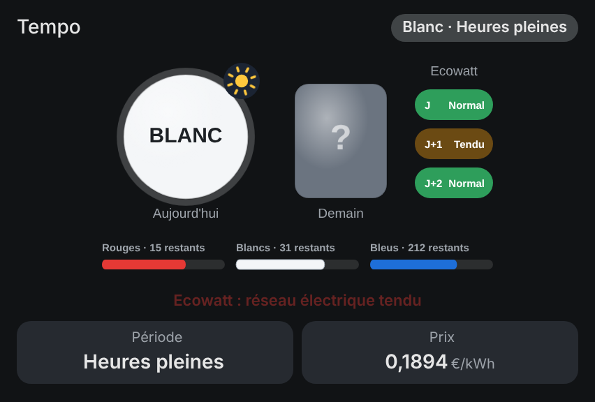
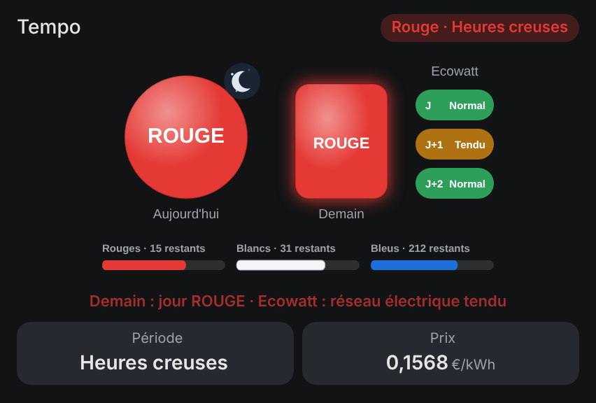

# Tempo Card pour Home Assistant

[](https://hacs.xyz)
[](LICENSE)

Carte Lovelace **animée** pour l'offre **Tempo d'EDF** et le signal **Ecowatt de RTE** : la couleur du jour, celle du lendemain, les heures creuses, les jours restants de la saison et la tension du réseau, d'un seul coup d'œil.

<p align="center">
  
  
</p>

**▶ [Essayer la démo](https://skyrotter.github.io/ha-tempo-card/docs/demo.html)** (données simulées, sans Home Assistant)

## Ce que montre la carte

- **Aujourd'hui** : un grand disque bleu, blanc ou rouge qui respire doucement (et bat comme un cœur un jour rouge), avec un **soleil** en heures pleines et une **lune** étoilée en heures creuses.
- **Demain** : une carte **« ? »** qui pulse tant que RTE n'a pas publié la couleur, puis **se retourne** quand elle tombe (vers 11 h).
- **Saison** : les jours **rouges, blancs et bleus restants** (22 rouges et 43 blancs par saison, du 1er septembre au 31 août).
- **Ecowatt** : trois pastilles J, J+1, J+2 (vert, orange, rouge) qui clignotent quand le réseau est tendu.
- **Alertes** : « Demain : jour ROUGE », « Jour rouge en heures pleines », « Ecowatt : réseau électrique tendu ».
- **Tuiles** : période en cours (HP / HC) et **prix du kWh** en cours si tu renseignes tes tarifs.

## Installation

**HACS (dépôt personnalisé)**

1. HACS → ⋮ → *Dépôts personnalisés* → ajoute `https://github.com/skyrotter/ha-tempo-card`, catégorie **Dashboard**.
2. Cherche **Tempo Card**, clique sur **Télécharger**, puis recharge le navigateur (Ctrl+F5).

**Manuelle**

1. Copie `ha-tempo-card.js` dans `/config/www/`.
2. Paramètres → Tableaux de bord → ⋮ → Ressources → ajoute `/local/ha-tempo-card.js` (module JavaScript).

## Sources de données

| Donnée | Intégration conseillée | Ou bien |
|---|---|---|
| Couleur du jour / du lendemain | [RTE Tempo](https://github.com/hekmon/rtetempo) | tout capteur dont l'état contient `bleu` / `blanc` / `rouge` (ou `blue` / `white` / `red`, 🔵 ⚪ 🔴) |
| Heures creuses | RTE Tempo (`binary_sensor` Heures Creuses) | l'option `off_peak` (plages horaires) |
| Jours restants | RTE Tempo (capteurs *Cycle Jours restants*) | tout capteur numérique |
| Ecowatt | [RTE Ecowatt](https://github.com/kamaradclimber/rte-ecowatt) (attribut `level_code`) | un capteur numérique 0 à 3 ou un texte (« normale », « risque », « coupure ») |

À l'ajout depuis le sélecteur de cartes, les entités de ces deux intégrations sont **détectées automatiquement**.

## Configuration

```yaml
type: custom:tempo-card
entity_today: sensor.rte_tempo_couleur_actuelle
entity_tomorrow: sensor.rte_tempo_prochaine_couleur
entity_offpeak: binary_sensor.rte_tempo_heures_creuses
entity_red_left: sensor.rte_tempo_cycle_jours_restants_rouge
entity_white_left: sensor.rte_tempo_cycle_jours_restants_blanc
entity_blue_left: sensor.rte_tempo_cycle_jours_restants_bleu
entity_ecowatt_today: sensor.ecowatt_level_today
entity_ecowatt_tomorrow: sensor.ecowatt_level_tomorrow
entity_ecowatt_day2: sensor.ecowatt_level_in_2_days
# tes tarifs (€/kWh), facultatif : affiche le prix en cours
price_blue_hp: 0
price_blue_hc: 0
price_white_hp: 0
price_white_hc: 0
price_red_hp: 0
price_red_hc: 0
```

Les noms exacts des entités dépendent de ton installation : vérifie-les dans Paramètres → Entités.

### Options

| Option | Rôle | Défaut |
|---|---|---|
| `entity_today` / `entity_tomorrow` | couleur du jour / du lendemain | |
| `entity_offpeak` | `binary_sensor`, `on` = heures creuses | |
| `off_peak` | plages d'heures creuses sans capteur, ex. `22:00-06:00` ou `01:00-07:00, 12:30-14:30` | `22:00-06:00` |
| `entity_red_left` / `entity_white_left` / `entity_blue_left` | jours restants de la saison | |
| `entity_ecowatt_today` / `entity_ecowatt_tomorrow` / `entity_ecowatt_day2` | niveau Ecowatt J, J+1, J+2 | |
| `price_<couleur>_<hp\|hc>` | prix du kWh (ex. `price_red_hp`) | |
| `entity_price` | capteur du prix en cours (à la place des 6 prix) | |
| `currency` | unité affichée avec les prix | `€` |
| `name` | titre de la carte | `Tempo` |
| `language` | `fr` ou `en` (sinon la langue de Home Assistant) | |
| `show_status`, `show_season`, `show_ecowatt`, `show_tiles`, `animations` | afficher / masquer | `true` |

## Bon à savoir

- La journée Tempo va de 6 h à 6 h. Avec RTE Tempo, la couleur « actuelle » change donc à 6 h, pas à minuit.
- La couleur du lendemain est publiée par RTE en fin de matinée : avant, la carte affiche « ? ».
- Le signal Ecowatt est vert la plupart du temps : les pastilles ne s'animent que quand le réseau est tendu.

## Licence

MIT. Données Tempo et Ecowatt fournies par RTE via les intégrations citées ; ce projet n'est affilié ni à EDF ni à RTE.

---

### English

Animated Lovelace card for the French **EDF Tempo** tariff and the **RTE Ecowatt** grid signal: today's and tomorrow's colour (a "?" card that flips when RTE publishes it), off-peak hours with a sun / moon, remaining red / white / blue days, Ecowatt for the next 3 days, current price. Works with the [RTE Tempo](https://github.com/hekmon/rtetempo) and [RTE Ecowatt](https://github.com/kamaradclimber/rte-ecowatt) integrations or any sensor whose state contains blue / white / red. Set `language: en` for English labels.
